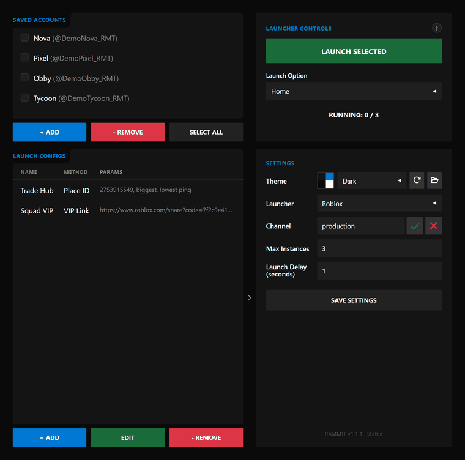

# RAMMIT

**Save your Roblox accounts once, tick the ones you want, and open a separate Roblox window for each with one click.** A free, open-source Windows app.

[](https://github.com/CBlockDigital/RAMMIT/actions/workflows/CI.yml)
[](https://github.com/CBlockDigital/RAMMIT/releases/latest)
[](LICENSE)



## Install

In PowerShell (Windows 10/11), one command downloads and runs the installer:

```powershell
irm https://github.com/CBlockDigital/RAMMIT/releases/latest/download/RAMMIT-Setup.exe -OutFile "$env:TEMP\RAMMIT-Setup.exe"; & "$env:TEMP\RAMMIT-Setup.exe"
```

Or [download RAMMIT-Setup.exe](https://github.com/CBlockDigital/RAMMIT/releases/latest/download/RAMMIT-Setup.exe) and double-click it. The installer also updates, repairs, switches versions and uninstalls.

Prefer no installer? Each [release](https://github.com/CBlockDigital/RAMMIT/releases/latest) also has `RAMMIT-<version>.zip` (unzip, run `RAMMIT\RAMMIT.exe`) and its `.sha256` checksum. Python isn't needed.

The exe isn't code-signed yet, so Windows SmartScreen may warn the first time.

**See it first:** [rammit-pi.vercel.app](https://rammit-pi.vercel.app), with screenshots and the 2-minute launch film.

## What it does

- Saves your Roblox logins on your own PC, encrypted with Windows DPAPI.
- Opens one official Roblox client per ticked account, one after another, with live progress.
- Sends them where you choose:
  - Home, a game URL, a place ID, an exact server (place + job ID) or a VIP link;
  - with server filters by player count or ping.
- Saves launch setups as named configs.
- Works with Roblox, Bloxstrap or Fishstrap.
- Themes: Dark, 2016 Roblox and CBlock, or make your own.

It does **not** farm, auto-play or run scripts, and it isn't affiliated with Roblox Corporation.

## What's in this repo

| Folder | What it is |
|---|---|
| [`Production/RAMMIT-Stable`](Production/RAMMIT-Stable) | The app (Python + pywebview + HTML/CSS/JS). Start with its [README](Production/RAMMIT-Stable/README.md). |
| [`Production/Installer`](Production/Installer) | `RAMMIT-Setup.exe`, the installer. See its [README](Production/Installer/README.md). |
| [`Web/Website`](Web/Website) | The website (static HTML/CSS/JS) on Vercel. |

- [CHANGELOG](Production/RAMMIT-Stable/CHANGELOG.md)
- [Security notes](Production/RAMMIT-Stable/SECURITY.md)
- [Contributing](CONTRIBUTING.md): questions go to [Discussions](https://github.com/CBlockDigital/RAMMIT/discussions), bugs to [Issues](https://github.com/CBlockDigital/RAMMIT/issues).

## License

Copyright (C) 2026 CBlock Digital. RAMMIT is free software under the [GNU General Public License v3.0](LICENSE): you can use, study, change and share it. If you distribute it, or anything built from it, you must share the source under the same license.
